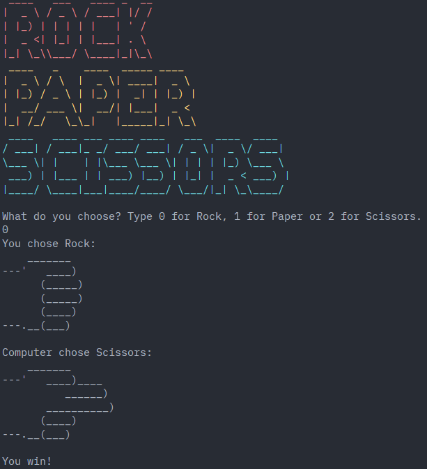

# 🚀 Rock Paper Scissors Game

A beginner-friendly Python program to play Rock, Paper, Scissors against the computer (Udemy's *100 Days of Code™: The Complete Python Pro Bootcamp*, Day 4).

## 📚 Table of Contents

- [Overview](#-overview)
- [Requirements](#-requirements)
- [Setup](#-setup)
- [Run](#-run)
- [Tests](#-tests)
- [License](#-license)
- [Links](#-links)

## 🧭 Overview

You choose `0` (Rock), `1` (Paper) or `2` (Scissors); the computer picks randomly using the `random` module. Both choices are shown as ASCII art, and the winner is decided with `if`/`elif`/`else` logic (rock beats scissors, scissors beats paper, paper beats rock). Draws and invalid input are handled.



## 📋 Requirements

- Python 3.13 or newer
- No runtime dependencies
- [pytest](https://pytest.org) for running the tests (installed via the `dev` extra)

## 🛠️ Setup

Create and activate a local virtual environment in `.venv`:

```bash
python -m venv .venv
```

Activate it:

```bash
# Windows (PowerShell)
.venv\Scripts\Activate.ps1

# Windows (cmd)
.venv\Scripts\activate.bat

# macOS / Linux / Git Bash
source .venv/bin/activate        # Git Bash on Windows: source .venv/Scripts/activate
```

Install the project in editable mode with test tools:

```bash
python -m pip install -e ".[dev]"
```

Leave the environment with `deactivate`.

## ▶️ Run

With the virtual environment active:

```bash
python -m rock_paper_scissors
```

or, after installing, `rock-paper-scissors`.

## 🧪 Tests

```bash
python -m pytest
```

## 📄 License

GNU Affero General Public License v3.0 or later (AGPL-3.0-or-later).

## 🔗 Links

- [Repository](https://git.tirsystem.com/Tirsvad-Udemy-100_days_of_code)
- [Documentation](https://git.tirsystem.com/Tirsvad-Udemy-100_days_of_code/004-rock_paper_scissors_game#readme)
- [Issue tracker](https://git.tirsystem.com/Tirsvad-Udemy-100_days_of_code/004-rock_paper_scissors_game/issues)
